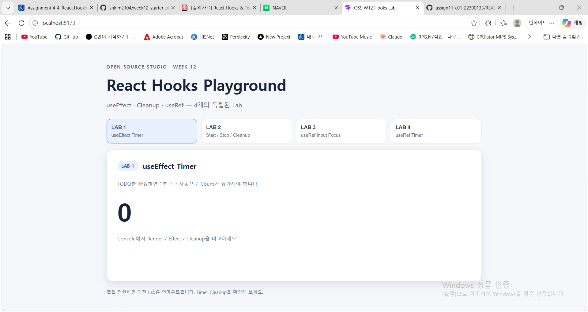
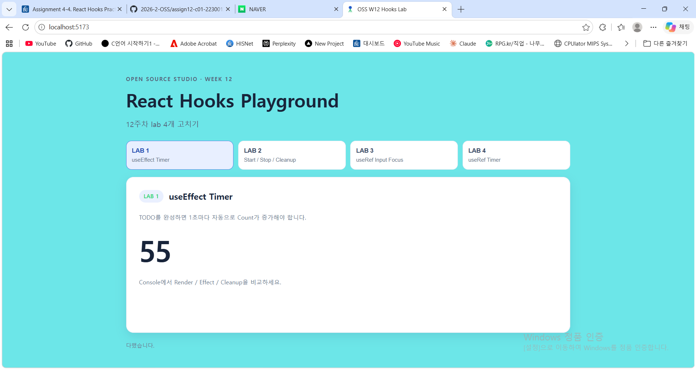
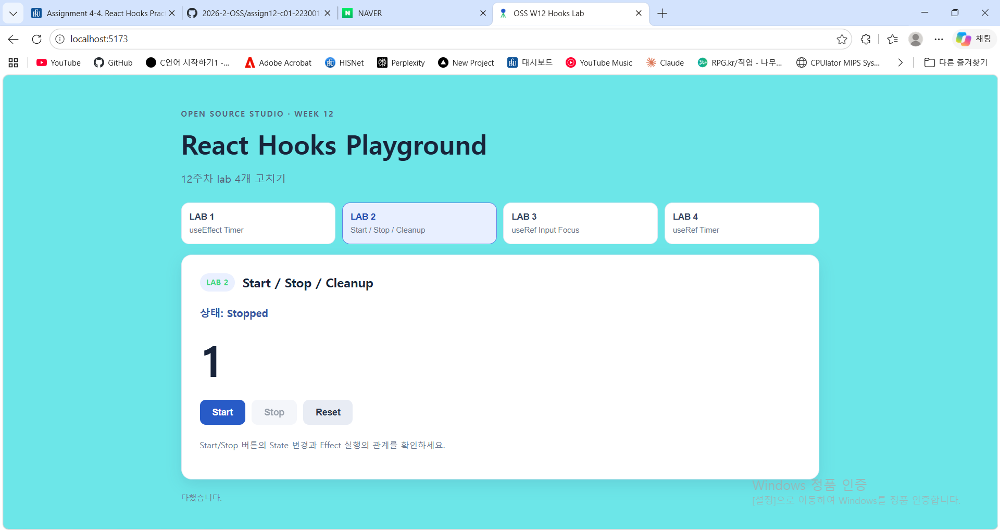
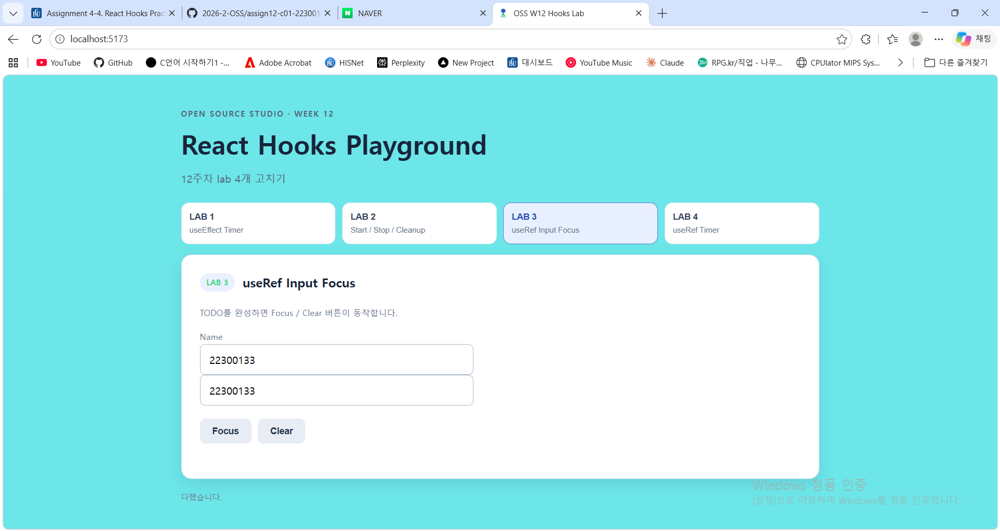
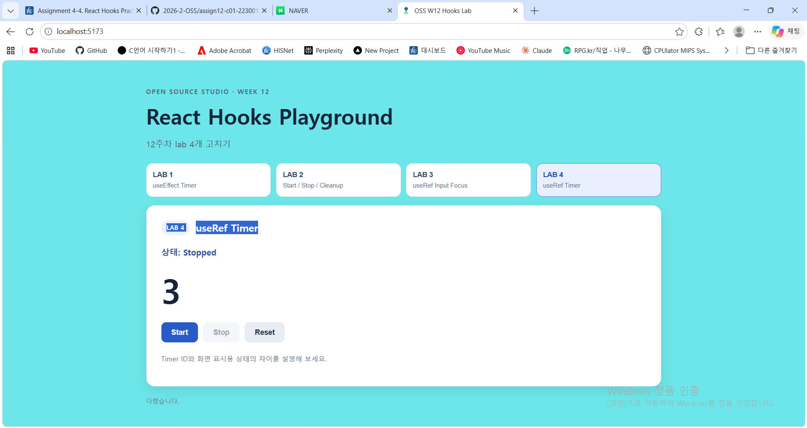

# OSS Week 12 — React Hooks Playground

React + Vite 기반의 React Hooks 실습 프로젝트입니다. 

## Project Information
- Starter Project : https://github.com/2026-2-OSS/week12_starter_project
- GitHub Repository : https://github.com/2026-2-OSS/assign12-c01-22300133

- Vercel : https://week12-starter-project-one-puce.vercel.app

## Installation
Node.js 20.19+ 권장.

npm install
npm run dev

- Starter Project 실행 화면

## Source Code Exploration

- App.jsx : `labs` 배열에 4개의 Lab 컴포넌트를 넣어두고, `active` state로 선택된 탭의 Lab만 화면에 보여줍니다. 탭을 바꾸면 이전 Lab은 언마운트되기 때문에 Cleanup이 실행되는지 확인할 수 있습니다.

### useEffect
- Effect : 렌더링이 끝난 뒤에 실행되는 작업입니다. (타이머, fetch, 이벤트 리스너 등)
- Dependency Array : effect를 언제 다시 실행할지 정합니다. `[]`이면 처음 한 번, `[값]`이면 그 값이 바뀔 때만 실행됩니다.
- Cleanup : effect에서 `return`한 함수로, 컴포넌트가 사라지거나 effect가 다시 실행되기 전에 이전 작업을 정리합니다.

### useRef
- useState : 값이 바뀌면 리렌더링, 화면에 보이는 값
- useRef : 값이 바뀌어도 리렌더링 안 됨, `.current`로 접근, DOM 접근·보관용

### 주요 코드 1 — useEffect (LAB 2)

useEffect(() => {
  if (!running){
    return;
  }
  const setIntervalId = setInterval(() => {
    setCount(prev => prev + 1);
  }, 1000);
  return () => {
    clearInterval(setIntervalId);
  };
}, [running]);

Dependency Array가 `[running]`이라서 Start/Stop 버튼으로 `running`이 바뀔 때마다 effect가 다시 실행되고, `running`이 false면 바로 return해서 타이머를 만들지 않고, true면 `setInterval`로 1초마다 count를 1씩 올립니다. `running`이 다시 false가 되면 이전 effect의 Cleanup이 먼저 실행되어 `clearInterval`로 타이머가 정리됩니다.

### 주요 코드 2 — useRef (LAB 4)

const timerRef = useRef(null);

const start = () => {
  if (!timerRef.current) {
    timerRef.current = setInterval(() => {
      setCount((prev) => prev + 1);
    }, 1000);
    setRunning(true);
  }
};

`timerRef.current`에 `setInterval`이 반환한 Timer ID를 저장하고, ref는 리렌더링이 되어도 값이 유지되기 때문에 나중에 stop에서 이 ID로 `clearInterval`을 할 수 있습니다. `timerRef.current`에 이미 값이 있으면 새 타이머를 만들지 않아서 중복 실행을 막아 동작효율성을 높혔습니다.

## Lab Implementation

### LAB 1. useEffect Timer
- setInterval로 1초마다 setCount(prev => prev + 1) 실행 (Functional State Update)
- Dependency Array를 []로 설정하여 처음 한 번만 타이머 생성
- Cleanup에서 `clearInterval(timerId)`로 타이머 정리

### LAB 2. Timer Start / Stop
- Start : setRunning(true) → effect에서 타이머 생성
- Stop : setRunning(false) → Cleanup에서 타이머 정리
- Reset : setRunning(false) 후 setCount(0)
- Dependency Array [running] 사용, Start 버튼은 실행 중일 때 disabled로 중복 실행 방지

### LAB 3. Input Focus with useRef
- useRef(null)로 inputRef 생성 후 <input ref={inputRef} />로 연결
- Focus : inputRef.current.focus()
- Clear : inputRef.current.value = "" 후 focus()

### LAB 4. Timer with useRef
- timerRef.current에 Timer ID 저장
- Start : timerRef.current가 비어있을 때만 타이머 생성 
- Stop : clearInterval(timerRef.current) 후 timerRef.current = null , setRunning(false)
- Reset : stop() 실행 후 setCount(0)
- useEffect(() => { return () => clearInterval(...) }, [])`로 언마운트 시 Cleanup

## Lab Comparison

### 1. useEffect의 Dependency Array가 필요한 이유는?
effect를 언제 다시 실행할지 정하기 위해서입니다. 없으면 렌더링마다 실행되어 불필요한 fetch나 무한 루프(effect 안에서 setState → 리렌더 → 다시 effect)가 생길 수 있습니다. []이면 처음 한 번, [값] 이면 그 값이 바뀔 때만 실행되어 성능과 정확성을 지킵니다.

### 2. Cleanup을 사용하지 않으면 어떤 문제가 발생할 수 있는가?
컴포넌트가 사라지거나 effect가 다시 실행돼도 이전 작업이 계속 남습니다.
- setInterval이 중복으로 쌓여 타이머가 2배, 3배로 빨라집니다.
- 이벤트 리스너가 계속 추가됨
- 메모리 누수, 언마운트된 컴포넌트에 setState 시도

### 3. useState와 useRef의 가장 중요한 차이는?
값이 바뀔 때 리렌더링이 일어나느냐입니다. useState는 바뀌면 화면을 다시 그리고, useRef는 .current가 바뀌어도 다시 그리지 않고 값만 유지합니다.

### 4. LAB 2와 LAB 4의 Timer 관리 방식은 어떻게 다른가?
LAB 2는 생명주기에 맞춰 자동 관리되고,  LAB 4는 ref로 id를 보관해 사용자가 수동 제어하는 차이가 있습니다.

## Customizing

src/App.jsx헤더 설명을 "12주차 lab 4개 고치기"로, footer를 "다했습니다."로 변경 |
src/App.css body 배경색 #f5f7fb → #6ce6e8
src/App.css.pill 글자색 #2850ac → #3bd77c
src/components/Lab2_TimerControl.jsx (선택 기능) Timer 실행 상태 표시 — Running / Stopped에 Reset 후 Cleared 상태 추가 

